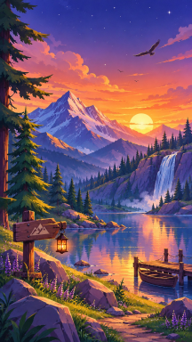
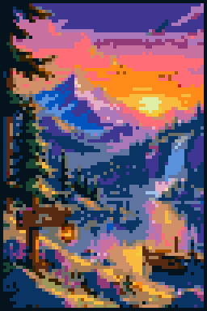
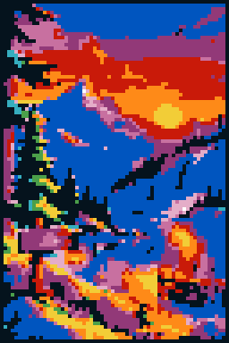
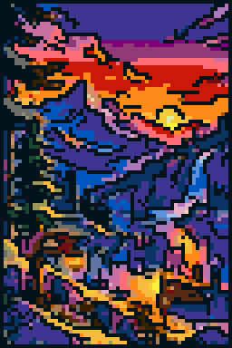
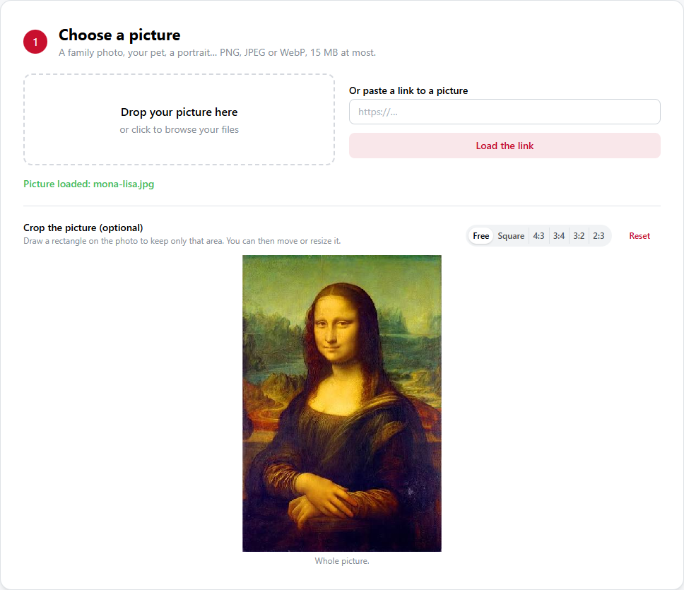
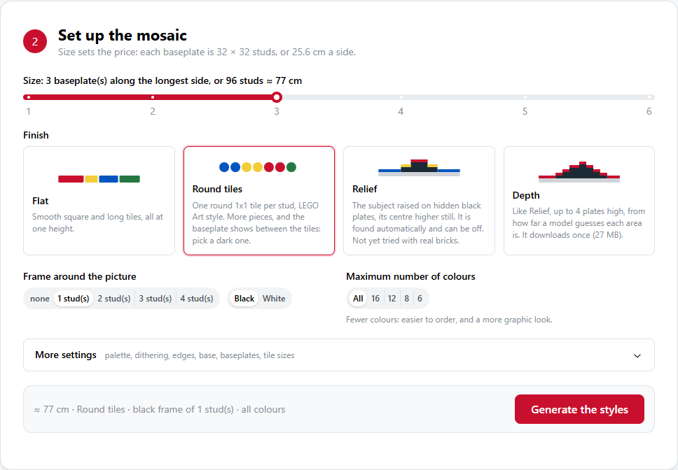
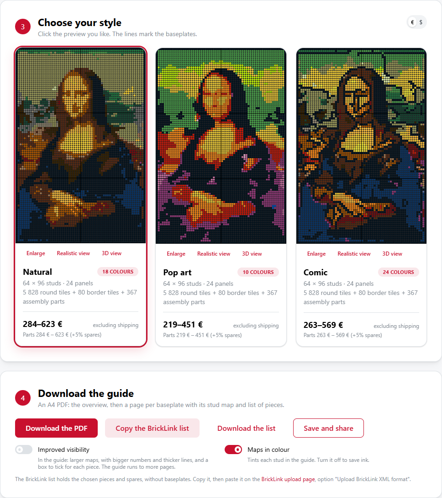
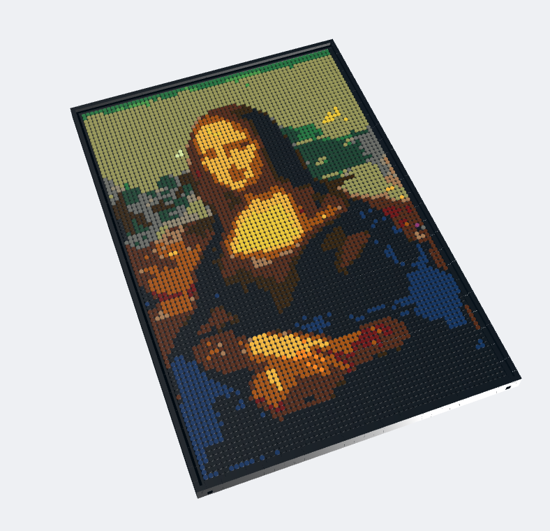

# Studify

[](https://www.python.org/)
[](https://github.com/astral-sh/uv)
[](https://github.com/astral-sh/ruff)
[](https://pre-commit.com/)
[](https://docs.pytest.org/)
[](https://dash.plotly.com/)
[](#disclaimer)

**Turn any photo into a LEGO mosaic, with a printable build guide, a parts list and a price estimate.**

> **Unofficial fan project.** Studify is not affiliated with, sponsored, authorized or
> endorsed by the LEGO Group. See the [disclaimer](#disclaimer).

<p align="center">
  
  &nbsp;➜&nbsp;
  
  
  
</p>

Pick a picture, choose how big it should be, and Studify:

- 🧱 snaps every pixel to a **real LEGO colour** you can actually buy,
- 🎨 offers three looks side by side: **natural**, **pop art** and **comic**,
- 📄 writes an **A4 build guide**, one page per 32x32 baseplate,
- 🛒 gives you a **BrickLink wanted list** to order every piece in one go,
- 💶 tells you roughly **what it will cost** before you buy anything.

## Quick start

You need [uv](https://docs.astral.sh/uv/getting-started/installation/) (it installs the right Python for you).

```bash
git clone https://github.com/Haha89/legoMe.git studify
cd studify
uv sync --extra web
uv run studify-web
```

Then open <http://127.0.0.1:8050> in your browser. That's it. Prefer the terminal? Jump to
[the command line](#command-line).

## A tour of the web app

**1. Choose a picture.** Drop a photo, or paste a link to one, and crop it if you like.



**2. Set up the mosaic.** The size sets the price: each baseplate is 32 x 32 studs, about
25.6 cm a side. Pick a finish (flat tiles, round tiles, or a raised relief), a frame and how
many colours to use. *More settings* holds the rest: palette, dithering, baseplates, tile sizes.



**3. Choose your style, then 4. download the guide.** Compare the three renders with their
prices, then download the PDF guide, copy the BrickLink list, or save a link to share.



**Check it in 3D** before you buy: every style has a *3D view* you can turn and zoom, and a
*Realistic view*.



**Example build guide:** [`docs/example-guide-mountain-lake.pdf`](docs/example-guide-mountain-lake.pdf): an
overview, one A4 page per baseplate with its stud map and pieces, then the colour reference.

## Install options

Requires [uv](https://docs.astral.sh/uv/) and Python 3.11+.

```bash
uv sync                  # core dependencies
uv sync --all-extras     # also install the web app and the depth relief
```

## Command line

```bash
# A 4-baseplate-wide mosaic of the sample image
uv run studify pics/dog.png --size 4

# Write the guide elsewhere, and skip the preview window and the browser
uv run studify pics/vador.png -s 2 -o ./guides --no-plot --no-open

# A 2-stud black frame around the picture, for a finished, framed look
uv run studify pics/alex.jpg -s 3 --frame 2

# A punchy, 8-colour version: cheaper to buy, and more pop-art
uv run studify pics/dog.png -s 3 --max-colors 8

# Pop-art or comic-book retouching before the mosaic
uv run studify pics/alex.jpg -s 3 --frame 2 --style pop
uv run studify pics/dog.png -s 3 --frame 2 --style comic

# Also write a BrickLink wanted list, to order the bricks in one go
uv run studify pics/dog.png -s 3 --bricklink
```

| Flag | Meaning |
| --- | --- |
| `image` | Path to the source image. |
| `-s`, `--size` | Baseplates along the longest side (default `4`). |
| `-o`, `--output-dir` | Where to write the guide (default `./output`). |
| `--no-plot` | Skip the matplotlib preview. |
| `--no-open` | Do not open the guide in a browser. |
| `--frame` | Frame this many studs wide around the mosaic (default `0`, max `15`). |
| `--frame-color` | Colour of the frame: `black` (default) or `white`. |
| `--palette` | Colours to draw from: `buyable` (default: no rare, pricey colours), `all`, or `common` only. |
| `--full-palette` | Also match trans, chrome, pearl, metallic and similar finishes. |
| `--colors` | Only use these LEGO colours, comma-separated, e.g. `"Black,White,Red"`. |
| `--max-colors` | Use at most N colours, chosen to best fit the image. |
| `--style` | Retouch the photo first: `natural` (default), `pop` (vivid, flat, short palette) or `comic` (black outlines). |
| `--dither` | Blend colours the palette lacks with Floyd-Steinberg dithering. |
| `--keep-strays` | Keep isolated bricks instead of merging them into their surroundings. |
| `--plain-maps` | Leave stud maps untinted, to save ink when printing the guide. |
| `--plates` | Plate sizes to use, comma-separated, from `1x1,1x2,1x3,1x4,2x2` (default: all). 1x1 is always included; `--plates 1x1` gives one plate per stud. |
| `--lang` | Language of the guide: `en` (default) or `fr`. |
| `--round-tiles` | Build the picture from round 1x1 tiles (BrickLink 98138), one per stud, in the colours they come in, and its border (frame and letterbox bars) from plates up to 1x4. Overrides `--plates`. Priced like 1x1 plates; the baseplate shows between the tiles, so pick a dark one. |
| `--relief` | Depth: `flat` (default) or `stepped` (subject raised 2 plates on hidden black plates, its centre 3). Built from plates, so not with `--round-tiles`. Stepped builds are untested with real bricks. |
| `--relief depth` | Like `stepped`, but up to 4 hidden plates follow how near each part of the picture looks, guessed by [Depth Anything V2 Small](https://github.com/DepthAnything/Depth-Anything-V2) (Apache-2.0). The 27 MB model downloads on first use, to `~/.cache/studify` (or `STUDIFY_CACHE`), and needs `uv sync --extra depth`. |
| `--assembly` | What to build on: `baseplates` (default), which need fixing to a rigid board, or `panels`: the pinned 16x16 panels and brick frame of the LEGO Art sets, all in the wanted list and the price. Other sizes are worked out from a 3 x 3 panel set and haven't been built. |
| `--sharp-edges` | Give each stud the colour covering most of it, so that edges between colours stay sharp, instead of blending into a third colour: for logos and flat graphics. Ignored with `--dither`. |
| `--accents` | With `--round-tiles`, turn a few golden spots to gold (Metallic Gold, Pearl Gold) and silvery ones to silver (Flat Silver), at most 2 % of the picture, unless a larger area very likely is metal. They shine in the 3D view. Ignored with `--max-colors`. |
| `--improved-visibility` | Print the guide with larger maps, bigger numbers, thicker lines and a box to tick for each piece. It runs to more pages. |
| `--bricklink` | Also write a BrickLink wanted list, `<image-name>-bricklink.xml`, beside the guide. |
| `--baseplates` | Price `official` LEGO baseplates (default) or cheaper `compatible` ones. |
| `--currency` | Currency of the price estimate: `EUR` (default) or `USD`. |

The guide lands at `<output-dir>/<image-name>.html`. Open it and print to PDF — the
stylesheet puts one baseplate on each page — or call `PdfCreator.generate_pdf`.

## Running and hosting the web app

```bash
uv sync --extra web
uv run studify-web                              # then open http://127.0.0.1:8050
uv run studify-web --host 0.0.0.0 --threads 8   # reachable from other machines
uv run studify-web --debug                      # Flask's server, with hot reload
```

The app and its guides are in French or English. Uploads are stored at 2000 pixels at most on the longest side.
PDFs are printed by a headless Chrome, Chromium or Edge; set `STUDIFY_BROWSER` to point at
one if it isn't found automatically.

It runs on [Waitress](https://docs.pylonsproject.org/projects/waitress/), a production
server, unless `--debug`. Pictures over 15 MB or 50 million pixels are refused before being
decoded, links are only downloaded from public addresses (checked again as the connection is
made, so DNS can't switch it to the server's own network), and at most 2 PDFs or depth reliefs
are made at once per process: others wait up to 30 seconds, then are asked to try again.

## As a library

```python
from studify.models.canvas import Canvas
from studify.models.pdf_creator import PdfCreator

canvas = Canvas(4)  # 4 baseplates on the longest side
canvas.fit_from_image("pics/dog.png")

print(canvas.shape)  # (rows, cols) in studs
print(canvas.get_distribution())  # {brick_id: count}
print(canvas.get_price().format())  # e.g. "718–1 445 €"

PdfCreator(canvas).generate_html(output_dir="output")  # or .generate_pdf(...)
```

## How it works

1. **Resize** — the image is scaled so its longest side is `size * 32` studs. The short
   side is padded with black up to a whole baseplate or, with a frame, the image is
   centre-cropped to fill the area inside it (`Canvas.resize_img`).
2. **Quantise** — each pixel is matched to the palette colour that *looks* closest
   (Euclidean distance in CIELAB, not raw RGB), optionally after narrowing the palette
   to the N colours that best fit the image, and optionally with Floyd-Steinberg
   dithering (`Canvas.fit_from_image`).
3. **Clean up** — unless dithering, a lone brick of a similar colour to its surroundings
   joins them, while real details like the glint in an eye stay (`utils.remove_stray_bricks`).
4. **Split** — the mosaic is cut into 32x32 sub-canvases, one per baseplate, left to right
   and top to bottom (`PdfCreator.get_bases`).
5. **Cover** — each baseplate is covered with the largest chosen plates that fit, scanning
   from the top left (`plates.pack_plates`).
6. **Render** — each baseplate becomes an HTML table of colour numbers, tinted with each
   stud's colour, where each plate is one outlined cell: a 1x4 is one long box with one
   number, a 1x1 a single square (`utils.make_map`).

## Ordering on BrickLink

`--bricklink` (or the web app's copy and download buttons) gives you a wanted list of the
plates a build uses, with 5 % spares, rounded up. On BrickLink's
[upload page](https://www.bricklink.com/v2/wanted/upload.page), choose "Upload BrickLink XML
format" and paste the file's contents: it takes text, not a file. The web app links to it. Baseplates are not in the list. Speciality finishes from
`--full-palette` aren't either; any a build uses are printed so you can add them by hand.
BrickLink accepts a line even if nobody makes that part in that colour, so Studify only
uses sizes listed in BrickLink's catalog for each colour (`bricklink.PART_COLORS`), and
its palettes leave out colours with no 1x1 plate. Colours chosen by hand with `--colors`
can still lack one; the CLI names them. Being known doesn't mean in stock: check sellers
before ordering.

By default the list and the guide use 1x1, 1x2, 1x3, 1x4 and 2x2 plates wherever a colour
allows, each within its baseplate, and the stud maps draw each plate as one box. Choose fewer
with `--plates`; 1x1 always stays, as it is the only plate that fits a lone stud.

## Painting the relief, saving and sharing

`uv run studify-web` opens in French or English, from the browser's preferences or the switch at
the top of the page. With a relief, "Edit the relief" lets you paint how high each stud stands:
the price, the BrickLink list, the 3D view and the guide all follow. A new render starts afresh, with a button to
bring the painted relief back.

"Save and share" keeps a project, which is the picture, the settings, the chosen style and the painted
relief, under a link such as `/p/<id>`. Opening the link copies the project into a new session, so
changes made afterwards never alter it: save again for a new link. Anyone with a link can see the
picture. Projects saved in a browser are listed in step 1, which can also delete them. They are
kept 90 days after they were last opened, in `~/.local/share/studify/projects` (or under
`STUDIFY_DATA`), up to 2 GB in all.

## Pieces

What shows is always smooth: square and rectangular tiles (BrickLink 3070, 3069, 63864, 2431
and 3068), or round 1x1 tiles (98138). Plates with studs are only used hidden, under a
`--relief stepped` subject, since nothing stacks on a tile.

## 3D view

Each style in the web app has a "Vue 3D" button: drag to turn the mosaic, scroll to zoom, double-click to
go back to the start. Buttons show the back, with its hangers, and an exploded view with the pins
between panels. The frame and the back are simplified. It draws every piece with [Three.js](https://threejs.org) (MIT), kept in `web/assets/vendor`
so that it works offline.

## Pricing

The estimate (`models/pricing.py`) is a range, not a quote:

- **Bricks** are priced by how easy their colour is to buy: common colours
  EUR 0.02–0.04 a 1x1 plate, uncommon ones EUR 0.05–0.12, rare (retired or short-lived)
  ones EUR 0.15–0.50; plus 5 % spares. Other parts cost a set multiple of that
  (`PART_PRICE_FACTORS`): 1x2, 2x2 and round tiles the same, 1x3 × 1.2, 1x4 × 1.5. These come
  from a few listings for black parts, so treat them as a rough guide.
- **Baseplates**: EUR 8.99 for official LEGO 32x32 plates, about EUR 2 for compatible ones.
- **Dollars** use a fixed rate (`USD_PER_EUR`), to update by hand.
- **Shipping is not included**; on BrickLink it often outweighs the parts on small orders.

Rare colours are left out by default (`--palette buyable`): on sample pictures that
barely changed the mosaic but cut its estimated price by about 5–30 %. Use `--palette all` to allow
them; any a build uses are then listed in the guide and the web app, as they make a
mosaic much dearer and can be hard to find in bulk at all. All figures are rough market
estimates (sources in the module), kept in plain tables so they are easy to update.

## Layout

```
studify/
  cli.py              argparse entry point (`studify`)
  process.py          image -> mosaic -> guide, one call
  export/             Jinja2 template, print stylesheet and the guide's wording
  models/
    brick.py          immutable Brick (palette id + RGB)
    bricklink.py      BrickLink colour ids and wanted-list XML
    brickstore.py     the orderable palette
    canvas.py         the brick grid: fitting, resizing, cost, plotting
    plates.py         covers a mosaic with larger plates
    pdf_creator.py    splits a canvas into baseplates and renders the guide
    pricing.py        colour rarity and the price estimate
    static.py         the 137 LEGO colours and DIM_BASE (32)
    style.py          the natural, pop and comic retouching
    utils.py          colour matching, cleanup, brick counting and stud-map HTML
  web/
    app.py            Dash web app (`studify-web`)
    service.py        everything it does, minus the UI
scripts/make_docs.py  regenerates the README's images and example guide
.github/workflows/    lint and tests on each pull request
tests/                pytest suite
pics/                 sample images
```

## Roadmap

Ideas not yet started are logged in [`ROADMAP.md`](ROADMAP.md).

## Develop

```bash
uv run pytest                       # tests, one worker per CPU (pytest-xdist)
uv run pytest -n0 tests/test_web.py # one process, to debug
uv run pytest --cov=studify         # tests with coverage
uv run ruff check .                 # lint
uv run ruff format .                # format
```

## Notes

- The palette in `static.py` has 137 entries but only 126 distinct RGB values (for example
  `Red` and `Trans-Red` are identical). `BrickStore.available_bricks` keeps the 85 plain,
  buildable colours — trans, chrome, speckle, glitter, pearl, metallic and glow-in-dark
  finishes are excluded, since several sit exactly on top of a plain colour (e.g. the
  discontinued `Speckle Black-Copper` is pure `(0, 0, 0)`, same as `Black`) and would
  otherwise win ties against it. Pass `--full-palette` to also match against those finishes.
- Colours with no 1x1 plate on BrickLink are left out of every `--palette`.
- By default, matching then also leaves out the rare colours (`--palette buyable`, 45
  colours); see [Pricing](#pricing).
- Brick ids in the guide are compact numbers (1 to N, for the N colours that guide uses);
  the guide's final table maps every id to its LEGO colour name, RGB and a swatch.
- Colour data is cross-checked against the LDraw colour reference and BrickLink's colour
  guide, but it isn't exhaustive, and it keeps some older names: `Flesh` is today's
  `Nougat`, `Dark Blue-Violet` is `Dark Royal Blue`. `Neon` and `Satin Trans-` finishes
  aren't in the palette yet.

## Disclaimer

Studify is an independent, unofficial fan project. It is **not affiliated with,
sponsored, authorized or endorsed by the LEGO Group**.

LEGO® and the LEGO logo, the brick and knob configurations and the minifigure are
trademarks and/or copyrights of the LEGO Group. The author claims no rights to them:
the LEGO name and colour names are used only to describe which real parts a mosaic
needs. Colour values come from the community-maintained LDraw and BrickLink references.

Prices are rough estimates for information only, not offers or quotes, and are not
endorsed by LEGO, BrickLink or any seller. Pictures you turn into mosaics remain
subject to their own copyright: only use images you have the right to use.
