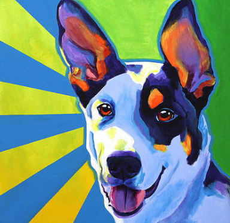
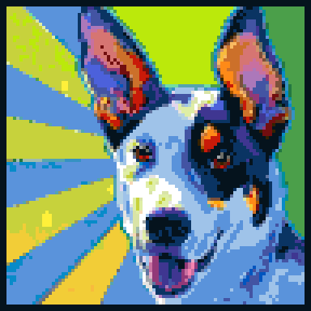
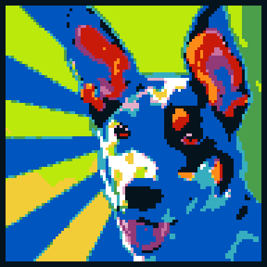
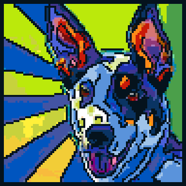

# LegoMe

[](https://www.python.org/)
[](https://github.com/astral-sh/uv)
[](https://github.com/astral-sh/ruff)
[](https://pre-commit.com/)
[](https://docs.pytest.org/)
[](https://dash.plotly.com/)
[](#disclaimer)

Turn any image into a LEGO mosaic and a printable, baseplate-by-baseplate build guide.

> **Unofficial fan project.** LegoMe is not affiliated with, sponsored, authorized or
> endorsed by the LEGO Group. See the [disclaimer](#disclaimer).

LegoMe downsamples your picture to whole 32x32 LEGO baseplates, snaps every pixel to the
nearest real LEGO colour, and writes an HTML guide with one stud map per baseplate, the
brick counts you need, and a cost estimate.

## Example

One picture, three styles, each 3 x 3 baseplates (96 x 96 studs, about 77 cm a side)
with a 2-stud black frame:

| Original | Natural | Pop (`--style pop`) | Comic (`--style comic`) |
| :---: | :---: | :---: | :---: |
|  |  |  |  |
| | 55 colours | 12 colours | 56 colours |
| | 402–809 € | 291–512 € | 353–676 € |

Prices are estimates with official LEGO baseplates, shipping excluded (see
[Pricing](#pricing)). The pop style's short palette makes it the cheapest to build.

**Example build guide:** [`docs/example-guide-dog.pdf`](docs/example-guide-dog.pdf), the
pop render at 2 x 2 baseplates. It opens with an overview, then has one A4 page per baseplate with
its stud map and the bricks it needs, then the colour reference.

Regenerate these with `uv run python scripts/make_docs.py`.

## Install

Requires [uv](https://docs.astral.sh/uv/) and Python 3.11+.

```bash
uv sync                  # core dependencies
uv sync --all-extras     # also install the optional GUI and web app
```

## Use

```bash
# A 4-baseplate-wide mosaic of the sample image
uv run legome pics/dog.png --size 4

# Write the guide elsewhere, and skip the preview window and the browser
uv run legome pics/vador.png -s 2 -o ./guides --no-plot --no-open

# A 2-stud black frame around the picture, for a finished, framed look
uv run legome pics/alex.jpg -s 3 --frame 2

# A punchy, 8-colour version: cheaper to buy, and more pop-art
uv run legome pics/dog.png -s 3 --max-colors 8

# Pop-art or comic-book retouching before the mosaic
uv run legome pics/alex.jpg -s 3 --frame 2 --style pop
uv run legome pics/dog.png -s 3 --frame 2 --style comic

# Also write a BrickLink wanted list, to order the bricks in one go
uv run legome pics/dog.png -s 3 --bricklink

# Graphical interface (needs `uv sync --all-extras`)
uv run legome --gui
```

| Flag | Meaning |
| --- | --- |
| `image` | Path to the source image. Required unless `--gui`. |
| `-s`, `--size` | Baseplates along the longest side (default `4`). |
| `-o`, `--output-dir` | Where to write the guide (default `./output`). |
| `--no-plot` | Skip the matplotlib preview. |
| `--no-open` | Do not open the guide in a browser. |
| `--frame` | Black frame this many studs wide around the mosaic (default `0`, max `15`). |
| `--palette` | Colours to draw from: `buyable` (default: no rare, pricey colours), `all`, or `common` only. |
| `--full-palette` | Also match trans, chrome, pearl, metallic and similar finishes. |
| `--colors` | Only use these LEGO colours, comma-separated, e.g. `"Black,White,Red"`. |
| `--max-colors` | Use at most N colours, chosen to best fit the image. |
| `--style` | Retouch the photo first: `natural` (default), `pop` (vivid, flat, short palette) or `comic` (black outlines). |
| `--dither` | Blend colours the palette lacks with Floyd-Steinberg dithering. |
| `--keep-strays` | Keep isolated bricks instead of merging them into their surroundings. |
| `--bricklink` | Also write a BrickLink wanted list, `<image-name>-bricklink.xml`, beside the guide. |
| `--baseplates` | Price `official` LEGO baseplates (default) or cheaper `compatible` ones. |
| `--currency` | Currency of the price estimate: `EUR` (default) or `USD`. |
| `--gui` | Launch the graphical interface. |

The guide lands at `<output-dir>/<image-name>.html`. Open it and print to PDF — the
stylesheet puts one baseplate on each page — or call `PdfCreator.generate_pdf`.

### Web app

```bash
uv sync --extra web
uv run legome-web        # then open http://127.0.0.1:8050
```

Upload a photo (or paste a link), crop it if you like, pick the size, frame, colour
limit, baseplates and currency, compare the natural, pop and comic renders side by side
with their prices, and download the chosen one as a PDF guide or a BrickLink wanted list.
Uploads are stored at 2000 pixels at most on the longest side.
PDFs are printed by a headless Chrome, Chromium or Edge; set `LEGOME_BROWSER` to point at
one if it isn't found automatically.

### As a library

```python
from legome.models.canvas import Canvas
from legome.models.pdf_creator import PdfCreator

canvas = Canvas(4)  # 4 baseplates on the longest side
canvas.fit_from_image("pics/dog.png")

print(canvas.shape)  # (rows, cols) in studs
print(canvas.get_distribution())  # {brick_id: count}
print(canvas.get_price().format())  # e.g. "129–228 €"

PdfCreator(canvas).generate_html(output_dir="output")  # or .generate_pdf(...)
```

## How it works

1. **Resize** — the image is scaled so its longest side is `size * 32` studs, with both
   sides rounded down to whole baseplates (`Canvas.resize_img`).
2. **Quantise** — each pixel is matched to the palette colour that *looks* closest
   (Euclidean distance in CIELAB, not raw RGB), optionally after narrowing the palette
   to the N colours that best fit the image, and optionally with Floyd-Steinberg
   dithering (`Canvas.fit_from_image`).
3. **Clean up** — unless dithering, a lone brick of a similar colour to its surroundings
   joins them, while real details like the glint in an eye stay (`utils.remove_stray_bricks`).
4. **Split** — the mosaic is cut into 32x32 sub-canvases, one per baseplate, left to right
   and top to bottom (`PdfCreator.get_bases`).
5. **Render** — each baseplate becomes an HTML table of brick ids, bordered around every
   run of same-coloured bricks so you can see the shapes while building
   (`utils.make_map`).

## Ordering on BrickLink

`--bricklink` (or the web app's "Liste BrickLink" button) writes a wanted list of 1x1
plates (part 3024), with 5 % spares. On BrickLink, go to Want > Upload, pick the XML tab
and paste the file's contents. Baseplates are not in the list. Speciality finishes from
`--full-palette` aren't either; any a build uses are printed so you can add them by hand.
Not every colour exists as a 1x1 plate, so check what BrickLink reports on upload.

## Pricing

The estimate (`models/pricing.py`) is a range, not a quote:

- **Bricks** are priced by how easy their colour is to buy: common colours
  EUR 0.02–0.04 a 1x1 plate, uncommon ones EUR 0.05–0.12, rare (retired or short-lived)
  ones EUR 0.15–0.50; plus 5 % spares.
- **Baseplates**: EUR 8.99 for official LEGO 32x32 plates, about EUR 2 for compatible ones.
- **Dollars** use a fixed rate (`USD_PER_EUR`), to update by hand.
- **Shipping is not included**; on BrickLink it often outweighs the parts on small orders.

Rare colours are left out by default (`--palette buyable`): on sample pictures that
barely changed the mosaic but cut its price by 35–50 %. Use `--palette all` to allow
them; any a build uses are then listed in the guide and the web app, as they make a
mosaic much dearer and can be hard to find in bulk at all. All figures are rough market
estimates (sources in the module), kept in plain tables so they are easy to update.

## Layout

```
legome/
  cli.py              argparse entry point (`legome`)
  process.py          image -> mosaic -> guide, one call
  gui.py              optional customtkinter front end
  export/             Jinja2 template + print stylesheet
  models/
    brick.py          immutable Brick (palette id + RGB)
    bricklink.py      BrickLink colour ids and wanted-list XML
    brickstore.py     the orderable palette and its prices
    canvas.py         the brick grid: fitting, resizing, cost, plotting
    pdf_creator.py    splits a canvas into baseplates and renders the guide
    pricing.py        colour rarity and the price estimate
    static.py         the 133 LEGO colours and DIM_BASE (32)
    style.py          the natural, pop and comic retouching
    utils.py          colour matching, cleanup, brick counting and stud-map HTML
  web/
    app.py            Dash web app (`legome-web`)
    service.py        everything it does, minus the UI
scripts/make_docs.py  regenerates the README's images and example guide
tests/                pytest suite
pics/                 sample images
```

## Develop

```bash
uv run pytest                       # tests
uv run pytest --cov=legome          # tests with coverage
uv run ruff check .                 # lint
uv run ruff format .                # format
```

## Notes

- The palette in `static.py` has 133 entries but only 122 distinct RGB values (for example
  `Red` and `Trans-Red` are identical). `BrickStore.available_bricks` keeps the 81 plain,
  buildable colours — trans, chrome, speckle, glitter, pearl, metallic and glow-in-dark
  finishes are excluded, since several sit exactly on top of a plain colour (e.g. the
  discontinued `Speckle Black-Copper` is pure `(0, 0, 0)`, same as `Black`) and would
  otherwise win ties against it. Pass `--full-palette` to also match against those finishes.
- By default, matching then also leaves out the 20 rare colours (`--palette buyable`, 61
  colours); see [Pricing](#pricing).
- Brick ids in the guide are compact numbers (1 to N, for the N colours that guide uses);
  the guide's final table maps every id to its LEGO colour name, RGB and a swatch.
- Colour data is cross-checked against the LDraw colour reference and BrickLink's colour
  guide, but it isn't exhaustive: common colours like `Dark Royal Blue`, `Coral`, the
  `Nougat` family and the `Neon`/`Satin Trans-` finishes aren't in the palette yet.

## Disclaimer

LegoMe is an independent, unofficial fan project. It is **not affiliated with,
sponsored, authorized or endorsed by the LEGO Group**.

LEGO® and the LEGO logo, the brick and knob configurations and the minifigure are
trademarks and/or copyrights of the LEGO Group. The author claims no rights to them:
the LEGO name and colour names are used only to describe which real parts a mosaic
needs. Colour values come from the community-maintained LDraw and BrickLink references.

Prices are rough estimates for information only, not offers or quotes, and are not
endorsed by LEGO, BrickLink or any seller. Pictures you turn into mosaics remain
subject to their own copyright: only use images you have the right to use.
